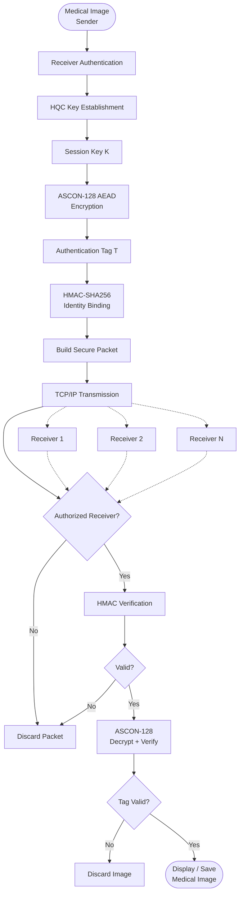

# Authenticated Secure Medical Image Transmission Using HQC and ASCON

A hardware-accelerated, post-quantum secure framework for transmitting medical images with confidentiality, integrity, and receiver authentication.

This project combines:

- HQC KEM for post-quantum session-key establishment
- ASCON-128 AEAD for authenticated image encryption
- HMAC-SHA256 for receiver identity binding and challenge-response authentication
- TCP/IP communication for reliable transmission
- FPGA acceleration for cryptographic speedup
- Software/hardware co-design for performance comparison

## Why this project matters

Medical images contain highly sensitive patient information. In healthcare systems, secure image transfer must protect against:

- unauthorized access
- tampering or data corruption
- impersonation and spoofed receivers
- replay attacks
- malicious interception on the network

This project addresses those risks by combining post-quantum key exchange with authenticated encryption and explicit receiver validation before any image is released.

---

## System overview

The proposed system follows a software-to-hardware design flow:

1. A secure cryptographic protocol is first implemented and validated in software.
2. Selected security modules are then accelerated on FPGA hardware.
3. System behavior is evaluated in terms of latency, throughput, resource usage, and security robustness.



---

## Key objectives

- Establish secure shared keys using HQC KEM
- Protect medical images with ASCON-128 authenticated encryption
- Verify the intended receiver using challenge-response authentication
- Bind receiver identity to the security context using HMAC-SHA256
- Prevent unauthorized receivers from accessing transmitted medical data
- Support communication with multiple authorized receivers
- Implement and compare software and FPGA accelerated versions
- Evaluate security, communication, and hardware performance

---

## Main security properties

| Security property | Mechanism | Purpose |
|---|---|---|
| Confidentiality | ASCON-128 encryption | Prevents unauthorized access to image contents |
| Integrity | ASCON authentication tag | Detects tampering or corruption |
| Authentication | HMAC-SHA256 challenge-response | Verifies the receiver identity |
| Binding | Challenge + receiver ID | Prevents misuse across sessions |
| Replay resistance | Fresh challenge per session | Stops reuse of old authentication data |
| Post-quantum key establishment | HQC KEM | Supports future-proof session-key establishment |

---

## Repository structure

```text
.
├── README.md
├── LICENSE
├── requirement.txt
├── project-plan/
│   └── README.md
├── software-implementation/
│   ├── README.md
│   ├── sender/
│   └── receiver/
└── ...
```

### Directories

- `software-implementation/` — software implementation of the cryptographic and communication pipeline
- `project-plan/` — project roadmap, milestone planning, and phase-wise development plan

---

## Software implementation

The software implementation demonstrates the end-to-end secure image transmission workflow. It includes:

- receiver authentication before transfer
- HQC-based shared session key establishment
- ASCON-128 encryption/decryption of medical images
- HMAC-based identity validation
- TCP/IP communication with authorized receivers
- CSV-based performance logging

For detailed documentation about the implementation, see:

- `software-implementation/README.md`

---

## Project plan

The project is organized into phases covering:

- requirement analysis
- authentication mechanisms
- HQC KEM implementation
- ASCON-based encryption
- secure communication
- FPGA acceleration
- complete framework integration
- performance evaluation
- final documentation

See `project-plan/README.md` for the roadmap and milestone status.

---

## Getting started

### Prerequisites

- Python 3.8+
- pip
- Linux environment recommended
- Access to required cryptographic libraries for HQC support

### Install dependencies

```bash
pip install -r requirement.txt
```

### Run the software receiver

```bash
cd software-implementation/receiver
python receiver.py
```

### Run the software sender

```bash
cd software-implementation/sender
python sender.py
```

> Note: configuration details such as receiver secrets and connection parameters should be stored in environment variables or a `.env` file and must not be committed to the repository.

---

## Example security flow

1. Sender connects to the selected authorized receiver
2. Receiver presents identity and receives a fresh challenge
3. Receiver computes an HMAC response
4. Sender verifies the challenge-response
5. Sender and receiver perform HQC key encapsulation/decapsulation
6. Shared symmetric session key is established
7. Image is encrypted using ASCON-128
8. HMAC binds identity and authenticity information
9. Encrypted packet is transmitted over TCP/IP
10. Receiver verifies HMAC first
11. If valid, ASCON decryption and tag verification are performed
12. Image is saved only after successful verification

---

## Performance focus

The system is designed to support evaluation of:

- cryptographic execution time
- network transmission delay
- end-to-end latency
- throughput
- FPGA resource utilization
- hardware/software performance comparison

---

## Security considerations

This repository is intended for research and prototyping. Some important project-level guidelines include:

- never hard-code authentication secrets
- store configuration values in environment variables
- use strong random challenges
- verify HMAC using constant-time comparison
- reject packets before decryption when authentication fails
- do not release plaintext if ASCON tag verification fails
- treat the software implementation as a prototype, not a production medical-data deployment

---

## License

This project is licensed under the MIT License. See `LICENSE` for details.

---

## Contributing

Contributions are welcome. If you are improving the cryptographic protocol, performance evaluation, FPGA integration, or documentation, please open an issue or submit a pull request with a clear description of the change.

---

## Summary

This project demonstrates a practical research-oriented model for secure medical image transmission using post-quantum key exchange and authenticated encryption. It balances cryptographic security, healthcare data protection, and FPGA acceleration in a single end-to-end framework.
